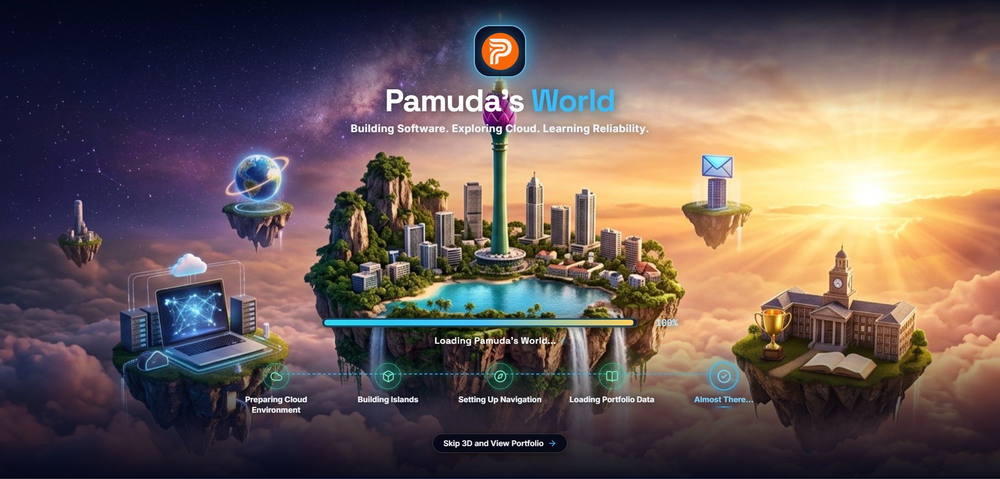

# Pamuda's World: Interactive 3D Portfolio

<p align="center">
  
</p>

> **Author:** Pamuda U. de A. Goonatilake  
> **Role:** Computer Science Undergraduate, University of Jaffna | Cloud Computing, DevOps & SRE  
> **Tagline:** Building Software. Exploring Cloud. Learning Reliability.  
> **Deployment Platform:** AWS Amplify Hosting + Amazon CloudFront  

---

## 🌟 Executive Overview

**Pamuda's World** is an interactive, high-performance 3D cloudverse portfolio that elevates the traditional developer showcase into a living celestial world. Visitors explore eleven sculpted floating islands above an animated cloud ocean, showcasing production software systems, distributed cloud architecture, community leadership, research publications, and interactive SRE simulations.

The application offers two complementary viewing experiences:
1. **3D Cloud Explorer Mode:** A full WebGL/Three.js experience with cinematic orbital camera navigation, interactive island rotation, raycast-occluded 3D labels, animated waterfalls, drifting cloud tracks, and split-screen inspection drawers.
2. **2D Portfolio Mode:** A high-speed, accessible executive interface featuring balanced navigation, verified project case studies, and credential verification.

---

## 🏝️ The 11 Standardized Islands

The archipelago features eleven floating islands arranged in an orbital celestial ring around the central Home Island:

1. **Home Island (Colombo, Sri Lanka):** The central landmark featuring the Colombo Lotus Tower, waterfront city skyline, central turquoise lagoon, and 4 cascading waterfalls plunging directly into dense bottom-layer clouds. Rotates continuously around its central axis.
2. **Projects Island:** Showcase of 20 verified software, cloud, web, and mobile systems with category filtering and interactive search.
3. **Skills Island:** Interactive technology matrix categorizing competencies across Cloud & AWS, DevOps, AI/ML, Backend, and Distributed Systems.
4. **Experience Island:** Professional engineering roles, internships, and production system delivery.
5. **Leadership Island:** Founding AWS Student Builder Group Leader community leadership and IEEE StudPro 9.0 executive milestones.
6. **Achievements Island:** Cloud-themed dais and glowing trophy display celebrating 8 hackathon wins and competitive programming honors.
7. **Education Island:** B.Sc. (Hons) in Computer Science at University of Jaffna, secondary education, and academic honors.
8. **Certifications Island:** Complete showcase of 21 verified credentials (AWS Certified Cloud Practitioner, Salesforce, Google Cloud, Postman, HackerRank, etc.) sorted chronologically.
9. **Open Source Island:** Global repositories, contributions, and cloud-native toolsets.
10. **Publications Island:** Peer-reviewed and community publications (*PyWhatKit: Automate WhatsApp with Python* in IEEENews@UoJ, *Kananiyam 2025*, and *AWS New Voices*).
11. **Contact Island:** Digital communication terminal with direct messaging, verified LinkedIn/GitHub links, and official CV downloads.

---

## 🎮 Core Interactions & Camera Controls

* **Full X & Y Axis Camera Freedom:** Click and drag left/right for full 360° horizontal azimuth rotation; click and drag up/down for vertical polar tilt from high celestial overhead (~15°) to eye-level cloud horizons (~92°).
* **Dual-Mode Zoom & Mobile Gestures:**
  * **Desktop:** Scroll in the open sky to zoom in/out (`minDistance: 18`, `maxDistance: 80`); hover over an island and scroll to step in 36° orbit increments.
  * **Mobile:** Fluid single-finger 360° touch rotation, two-finger pinch-to-zoom, and bottom dock arrows for island step-rotation.
* **Interactive Navigation Tour for 1st-Time Visitors:**
  * A 5-step celestial guided walkthrough automatically presented to first-time visitors upon entering the 3D world (or launchable anytime via the top HUD Tour button, the mobile drawer, or the Wayfinder).
  * Unblurred 3D backdrop keeping the floating islands, Lotus Tower, and living sky razor-sharp during navigation steps.
  * Features 3D island camera framing for each step, a glowing progress pill indicator, and context-aware tips adapting between desktop mouse controls and mobile touch gestures.
* **Continuous Living World Motion:**
  * **Surrounding Islands Orbit:** All 10 outer islands continuously revolve in a peaceful circular track around Home Island.
  * **Home Island Self-Rotation:** Home Island rotates slowly on its own axis, presenting a 360° view of the Lotus Tower and city waterfront.
* **Smart 3D Depth & Screen-Space Silhouette Occlusion:**
  * Mathematical screen-space line-of-sight tests against Home Island's 3D geometry (the Lotus Tower bulb, spire, and hills), ensuring background island labels never render on top of foreground structures.
  * When an island is clicked, its label dynamically transitions to the back side of the island as an elevated backdrop banner.
* **Top-Layer Modal Architecture:** Popups (Cloud Navigation Wheel, CloudOps Game, Skills Console, Journey, CV, Journal, Tour) render on top (`z-[100]` to `z-[130]`), automatically hiding 3D labels behind the modal backdrop.
* **Miniature Cloud Cursor:** Custom ambient cloud-inspired cursor with subtle trailing mist particles and interactive click ripples (automatically disabled on mobile/touch devices to conserve battery).

---

## 📱 Mobile Architecture & 425px Standard

* **425px Baseline Responsive Design:** Comprehensive viewport optimization ensuring fluid usability across modern smartphones down to a 425px minimum width with zero horizontal clipping.
* **Mobile 3D Navigation Drawer:**
  * A center-bottom glowing trigger button (`[✨ Explore Islands ⌃]`) floating cleanly above the cloud ocean.
  * Tapping slides up an ergonomic glassmorphic bottom sheet containing all 11 island shortcuts, 2D/3D toggle, guided tour trigger, sky themes, and audio controls.
  * Hides bulky horizontal desktop docks on mobile screens to preserve maximum 3D canvas visibility.
* **Mobile 2D Portfolio Header:**
  * Clean top navigation bar featuring the brand logo, a dedicated glowing **`🌍 3D World`** toggle button, and a hamburger menu side-by-side with comfortable clearance.
  * Mobile drawer offers quick jump links, direct CV downloads, and one-tap switching to the 3D experience.

---

## ☁️ Atmospheric & Visual Features

* **Cinematic Welcome & Loading Screen:** Real-time asset preloading sequence with 5 distinct deployment stages, animated progress tracking, and balanced text shadows for readability over the high-contrast sunrise background.
* **Clean Frosted Welcome Panel:** High-contrast, clean typography on the dark glassmorphic modal overlay (`HeroOverlay`) without blurred text halos.
* **Thematic Background Celestial Objects:** Distant orbital telecommunication satellites with solar arrays and pulsing SRE beacons, floating Kubernetes/AWS architecture data pods, and high-altitude celestial research drones.
* **Multi-Tiered Volumetric Clouds:** Solid, fluffy white cumulus cloud formations cradling the bottom rock keels of all surrounding islands and catching the waterfall streams of Home Island.
* **Time-of-Day Sky Atmosphere:** Dynamic celestial shader supporting **Sunrise/Dawn**, **Daylight**, and **Night** themes with sun glare and starfields.
* **CloudOps Incident Simulator:** Interactive SRE game simulating high-traffic system degradation, rate limiting, circuit breaker deployment, and database pool hot-patching.

---

## 🛠️ Technology Stack

* **Frontend Framework:** React 18 with TypeScript
* **Build Tool:** Vite 8
* **3D Engine:** Three.js, React Three Fiber (`@react-three/fiber`), Drei (`@react-three/drei`)
* **Styling & Design System:** Tailwind CSS, Lucide React, Glassmorphism
* **Animation:** Framer Motion, Canvas Confetti
* **Deployment & CDN:** AWS Amplify Hosting, Amazon CloudFront

---

## 🚀 Local Development

```bash
# Clone repository
git clone https://github.com/pamuda/pamuda-portfolio.git
cd pamuda-portfolio

# Install dependencies
npm install --legacy-peer-deps

# Start development server
npm run dev

# Run production build
npm run build

# Preview production build locally
npm run preview
```

---

## 📄 License

This project is open-source under the [MIT License](LICENSE).
